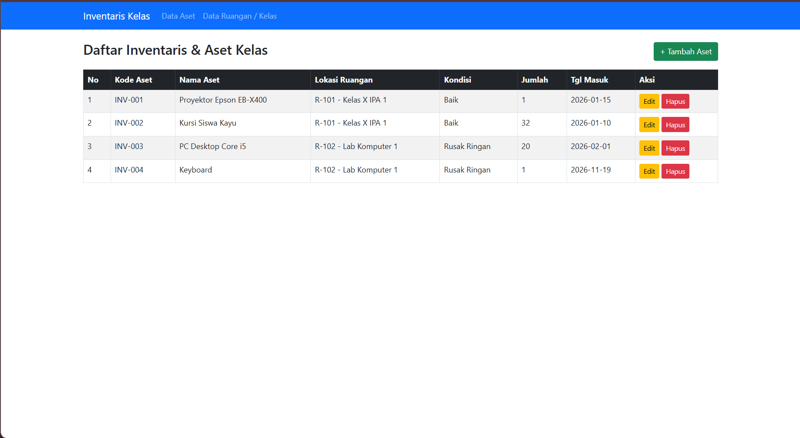
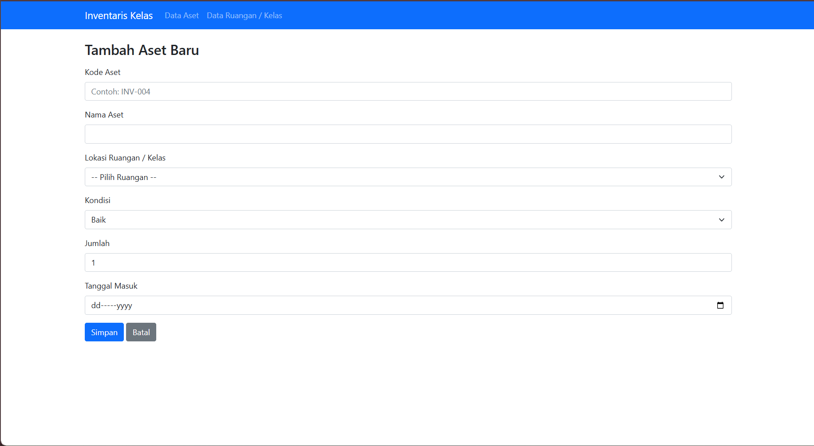
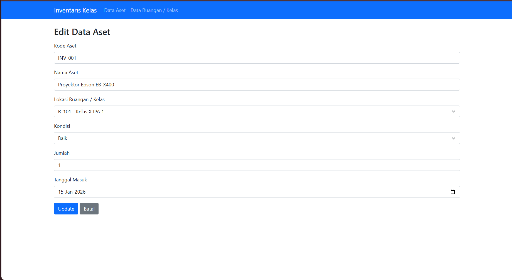
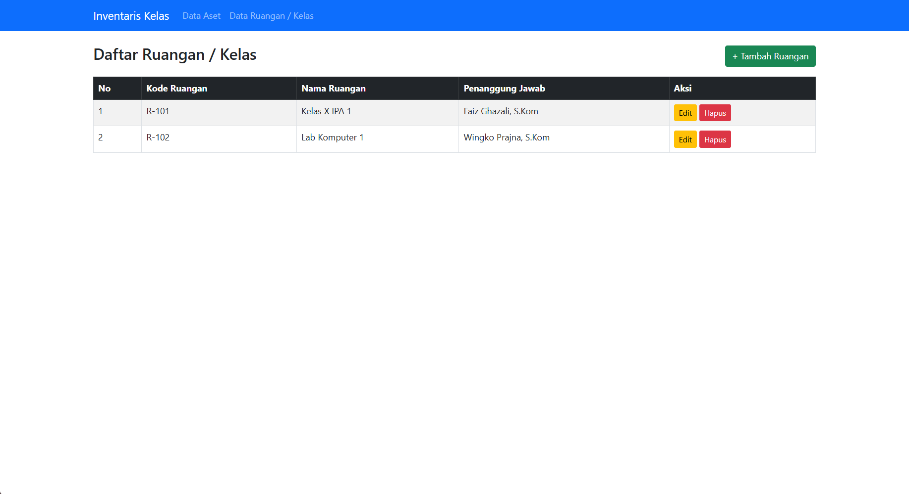
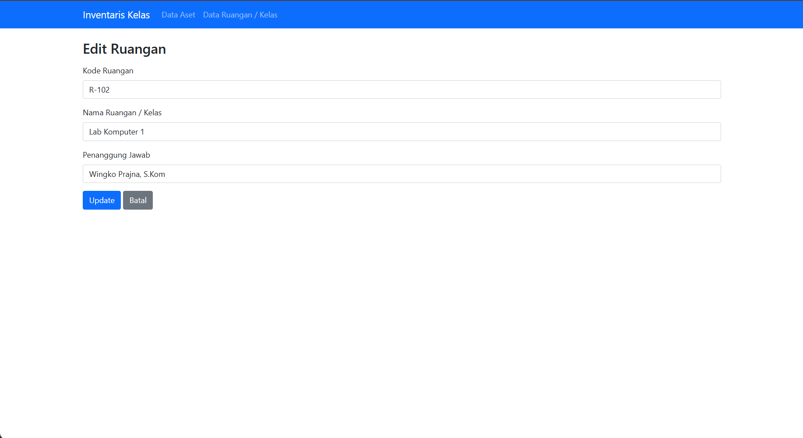
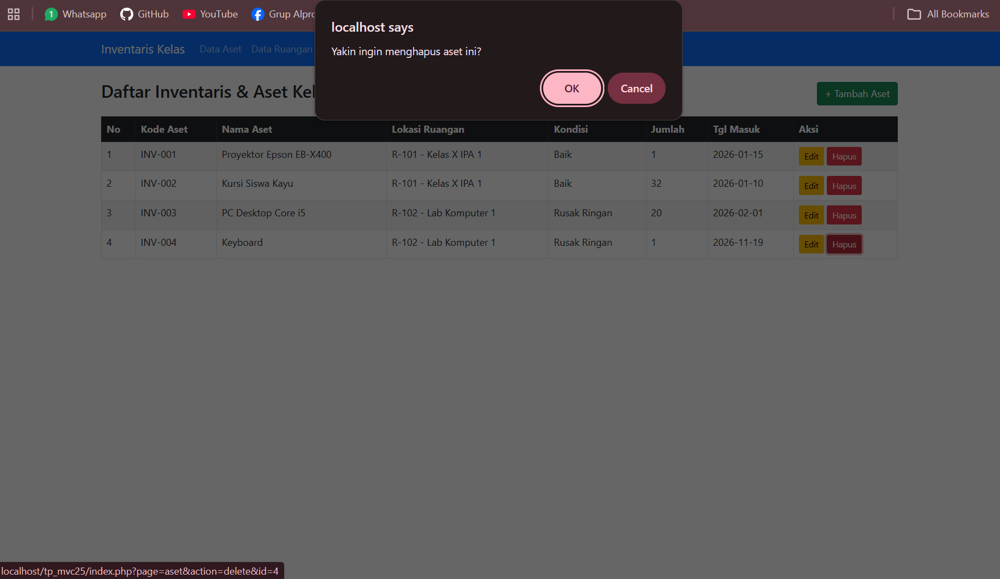
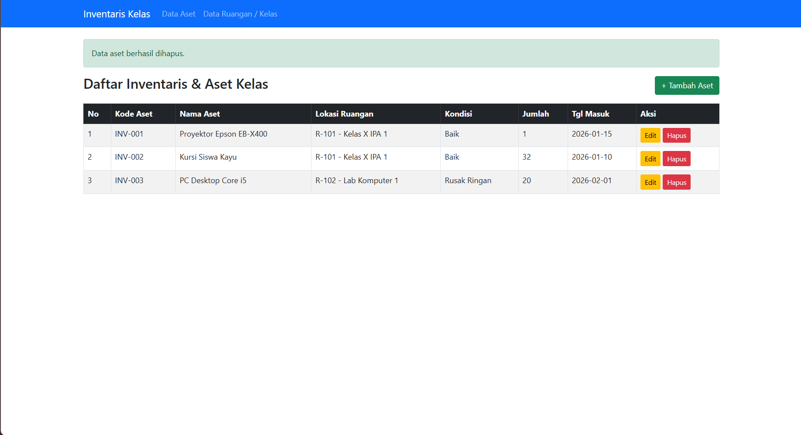

# TP 8 DPBO 25 26 C1 
Model View Controller   

# Janji Janji Seribu Janji
Saya <strong>Faiz Muhammad Ghazali</strong> dengan <strong>NIM 2504531</strong> mengerjakan TP 8 dalam mata kuliah Desain dan Pemrograman Berorientasi Objek untuk keberkahanNya maka saya tidak melakukan kecurangan seperti yang telah dispesifikasikan. Aamiin.

# Sistem Manajemen Inventaris & Aset Kelas (Arsitektur MVC)

Program aplikasi web sederhana berbasis PHP native dan MySQL untuk mengelola data aset/inventaris dan ruangan/kelas dengan menerapkan pola arsitektur **Model-View-Controller (MVC)**.

---

## 1. Desain Program

Program ini dirancang menggunakan konsep pemrograman berorientasi objek (OOP) dan memisahkan logika aplikasi ke dalam pola arsitektur **MVC (Model-View-Controller)** agar struktur kode rapi, modular, dan mudah dipelihara.

### A. Struktur Arsitektur (MVC)

1. **Konfigurasi & Basis Data (`tp_mvc25/config.php` & `tp_mvc25/db_inventaris_kelas.sql`)**
  - **`config.php`**: Menyimpan konstanta kredensial koneksi basis data (`DB_HOST`, `DB_USER`, `DB_PASS`, dan `DB_NAME`).
  - **`db_inventaris_kelas.sql`**: Skrip SQL untuk inisialisasi basis data `db_inventaris_kelas`, pembuatan tabel beserta relasinya, serta pengisian data awal (*dummy data*).

2. **Model (`tp_mvc25/models/`)**
  - Bertanggung jawab atas pengelolaan data dan interaksi langsung dengan basis data MySQL menggunakan *prepared statements* (`mysqli`).
  - **`Database.php`**: Kelas induk pembungkus koneksi basis data (`mysqli`) yang menyediakan properti koneksi `$conn` untuk diwariskan ke kelas model turunan.
  - **`Ruangan.php`**: Mewarisi kelas `Database`, menangani operasi CRUD untuk tabel ruangan (`ruangan`), termasuk penanganan *exception* saat penghapusan data yang masih memiliki relasi.
  - **`Aset.php`**: Mewarisi kelas `Database`, menangani operasi CRUD untuk tabel aset (`aset`) serta penggabungan (*INNER JOIN*) dengan tabel ruangan untuk menampilkan lokasi aset.

3. **View (`tp_mvc25/view/`, `tp_mvc25/template/`, & `tp_mvc25/assets/`)**
  - Bertanggung jawab atas penyajian data ke dalam antarmuka visual (UI) pengguna berbasis Bootstrap.
  - **`template/header.php` & `template/footer.php`**: Berkas kerangka tata letak (*layout*) global yang memuat navigasi utama (*navbar*) serta aset CSS/JS lokal (`assets/`).
  - **`view/ruangan/` (`index.php`, `create.php`, `edit.php`)**: Berkas tampilan untuk menampilkan daftar ruangan/kelas, formulir tambah ruangan, dan formulir ubah data ruangan.
  - **`view/aset/` (`index.php`, `create.php`, `edit.php`)**: Berkas tampilan untuk menampilkan daftar inventaris aset, formulir tambah aset, dan formulir ubah data aset (lengkap dengan pilihan *dropdown* lokasi ruangan dan kondisi aset).

4. **Controller (`tp_mvc25/controllers/`)**
  - Bertindak sebagai pengendali utama logika bisnis dan penghubung antara Model dan View.
  - **`RuanganController.php`**: Mengontrol alur data ruangan (`index`, `create`, `store`, `edit`, `update`, `delete`), termasuk mengirimkan parameter status notifikasi apabila penghapusan gagal akibat kendala *Foreign Key*.
  - **`AsetController.php`**: Mengontrol alur data aset (`index`, `create`, `store`, `edit`, `update`, `delete`), dengan mengambil data dari model `Aset` dan `Ruangan` secara bersamaan saat menampilkan formulir tambah/ubah aset.

5. **Router / Entry Point (`tp_mvc25/index.php`)**
  - Berfungsi sebagai gerbang utama (*entry point*) aplikasi web.
  - Menangkap parameter dari URL (`page` dan `action`), menginisialisasi controller yang sesuai (`AsetController` sebagai default atau `RuanganController`), lalu memanggil metode aksi yang diminta.

### B. Struktur Basis Data (Relasi Antar Tabel)

Basis data `db_inventaris_kelas` terdiri dari dua tabel utama yang saling berelasi:
- **`ruangan`** *(Parent Table)*: Menyimpan data ruangan/kelas dengan kolom `id_ruangan` (Primary Key, Auto Increment), `kode_ruangan` (Unique), `nama_ruangan`, dan `penanggung_jawab`.
- **`aset`** *(Child Table)*: Menyimpan data inventaris dengan kolom `id_aset` (Primary Key, Auto Increment), `kode_aset` (Unique), `nama_aset`, `kondisi` (`ENUM`: `'Baik'`, `'Rusak Ringan'`, `'Rusak Berat'`), `jumlah`, `tanggal_masuk`, dan `id_ruangan` (Foreign Key).
- **Relasi**: Foreign Key `aset.id_ruangan` merujuk pada `ruangan.id_ruangan` dengan aturan `ON DELETE RESTRICT ON UPDATE CASCADE` (Relasi *One-to-Many*: satu ruangan dapat menampung banyak aset, dan ruangan tidak dapat dihapus selama masih memiliki data aset).

---

## 2. Alur Cara Kerja Program

### A. Alur Siklus Permintaan (Request Lifecycle)
[ Pengguna / Browser ]
│ (Request URL: page, action, id)
▼
[ index.php ] ──(Routing)──► [ Controller ]
│       ▲
(Query Data)     │       │ (Data / Result)
▼                ▼       │
[ Model ] ◄───► [ Database ]  │
│                        │
└────────(Kirim Data)────┘
│
▼
[ Template & View ]
│
▼ (Render HTML)
[ Tampilan Browser ]

1. **Permintaan Pengguna (Request)**: Pengguna mengakses URL tertentu di browser (misal: `index.php?page=aset&action=index`).
2. **Pemeriksaan Rute (Routing)**: Berkas `index.php` memuat konfigurasi (`config.php`), membaca parameter `page` untuk menentukan controller (`AsetController` atau `RuanganController`), dan membaca parameter `action` untuk menentukan metode yang akan dijalankan.
3. **Pemrosesan pada Controller**:
  - Jika meminta halaman tampilan (`index`, `create`, `edit`), Controller mengambil data dari Model terkait lalu memuat berkas `template/header.php`, berkas `view/...`, dan `template/footer.php`.
  - Jika menerima kiriman formulir POST (`store`, `update`) atau permintaan hapus (`delete`), Controller memanggil metode eksekusi pada Model lalu mengalihkan (*redirect*) halaman kembali ke daftar utama.
4. **Penyajian Tampilan (Render View)**: Berkas tampilan di dalam direktori `view/` merender struktur tabel maupun formulir HTML dengan menyisipkan data dari Controller secara aman (`htmlspecialchars`).

### B. Alur Kerja Fitur CRUD

1. **Menampilkan Data (Read)**:
  - Pengguna membuka halaman utama modul (`action=index`).
  - Controller memanggil metode `getAll()` pada Model (`Aset` melakukan `JOIN` dengan `ruangan`).
  - Data diiterasi dan ditampilkan dalam bentuk tabel HTML pada `view/<modul>/index.php`.
2. **Menambah Data (Create & Store)**:
  - Pengguna menekan tombol tambah (`action=create`).
  - Controller menampilkan formulir input kosong (`create.php`); khusus modul aset, daftar ruangan diambil dari model `Ruangan` untuk mengisi *dropdown* lokasi.
  - Pengguna mengisi formulir dan mengirimkannya melalui metode `POST` ke `action=store`.
  - Controller meneruskan input ke metode `insert()` pada Model menggunakan *prepared statement*, lalu mengalihkan halaman ke `index.php?page=<modul>`.
3. **Mengubah Data (Edit & Update)**:
  - Pengguna menekan tombol *Edit* pada salah satu baris (`action=edit&id=...`).
  - Controller mengambil data spesifik berdasarkan `id` melalui metode `getById()` pada Model dan menampilkannya ke dalam formulir `edit.php`.
  - Saat formulir dikirimkan ke `action=update`, Controller memanggil metode `update()` pada Model dan mengalihkan halaman kembali ke daftar data.
4. **Menghapus Data (Delete)**:
  - Pengguna menekan tombol *Hapus* pada baris data (`action=delete&id=...`) dan menyetujui konfirmasi JavaScript.
  - Controller memanggil metode `delete($id)` pada Model.
  - Pada modul ruangan, jika ruangan masih digunakan oleh data aset, penghapusan ditolak oleh *constraint* `ON DELETE RESTRICT` dan pengguna diarahkan kembali dengan pesan peringatan (`status=error_fk`); jika berhasil, data dihapus dan muncul notifikasi (`status=deleted`).

---

## 3. Dokumentasi

1. Daftar Aset  
 

2. Form Tambah Aset   
 

3. Form Edit Aset  
 

4. Daftar Ruangan / Kelas  
 

5. Form Tambah Ruangan  
 

6. Form Edit Ruangan  
 

7. Penghapusan Data  
 
 
